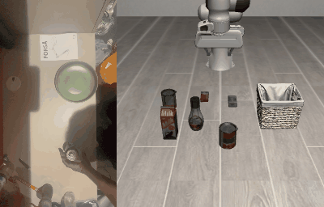
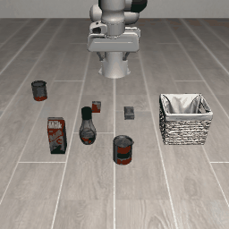
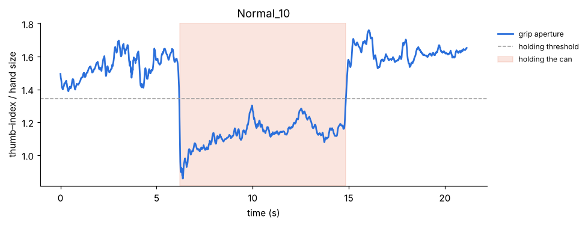
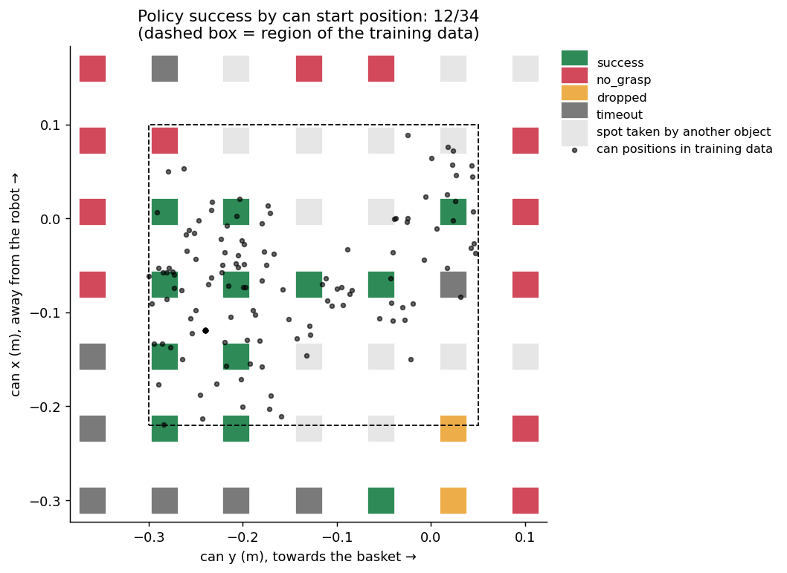
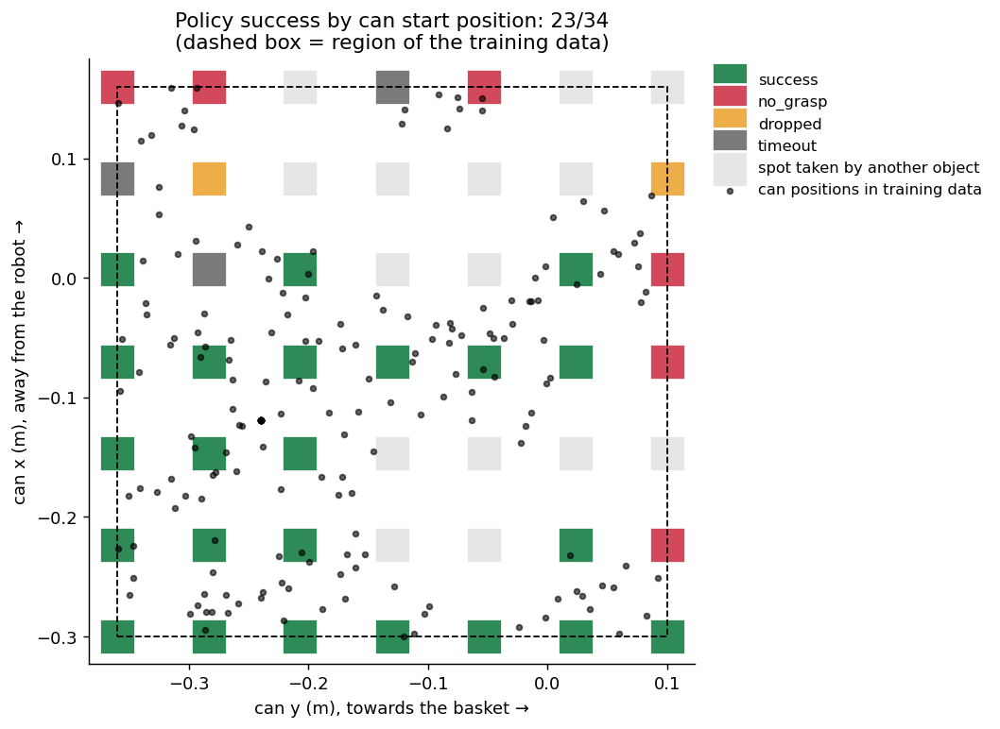

# From my hand to a robot arm

I recorded 20 phone videos of my own hand putting a can into a bowl, and used them to
teach a simulated Panda arm the same task in LIBERO (*"pick up the alphabet soup and
place it in the basket"*). I picked this task because I could do it at home with a real
can.



## Results

| | |
|---|---|
| Clips I recorded | 20 (16 normal, 4 edge cases) |
| Clips where I found the grasp and release | 20 / 20 |
| Robot replays of my clips that succeed | 195 / 208 |
| First policy | 12 / 34 can positions |
| **Final policy** | **23 / 34 can positions** |



## How it works

1. **Hand tracking.** MediaPipe gives me 21 hand keypoints per frame. I track one number:
   the gap between my thumb and index finger, divided by hand size. It drops while I
   hold the can, so the low stretch where my hand travels furthest gives me the grasp
   and the release. I never detect the can itself.
2. **Retargeting.** My grasp point maps to the can and my release point to the basket.
   Those two pairs fix a rotation, scale and shift, so I can put my hand path on the
   robot's table without calibrating the camera. My phone saw no depth, so the robot
   takes its height from the stage of the task.
3. **More demos from the same clips.** I can redo that mapping for any can position, so I
   replayed each clip at 8 to 12 extra spots and recorded small random pushes alongside
   the clean correction. My 16 normal clips became about 200 robot demos.
4. **Policy.** A 3-layer MLP reads 14 numbers about the gripper, can and basket. The final
   version predicts the next 10 actions, carries out 5, then predicts again (action
   chunking, from ACT).
5. **Testing.** I start the can at 34 free spots on a 7×7 grid, wider than anywhere I put
   it while filming, and label each failure.



| First policy, 12 / 34 | Final policy, 23 / 34 |
|---|---|
|  |  |

Green squares are successes. Black dots show where the training cans were, and the dashed
box marks that region.

## What I tried

Each row changes one thing. "Inside" counts the 11 grid spots within the region my
clips covered.

| # | Policy | Inside (11) | Outside (23) | Total (34) |
|---|---|---|---|---|
| 1 | Behaviour cloning, replays in my demo region | 9 | 3 | 12 |
| 2 | Same, each demo replayed **once** (no augmentation) | 0 | 0 | 0 |
| 3 | Same, only 4 of my clips | 4 | 1 | 5 |
| 4 | Same, only 8 of my clips | 8 | 2 | 10 |
| 5 | #1 + self-improvement (3 rounds) | 6 | 1 | 7 |
| 6 | Behaviour cloning, replays over the **whole table** | 1 | 4 | 5 |
| 7 | #1 + action chunking | 10 | 4 | 14 |
| 8 | #7 but re-plan every step | 4 | 1 | 5 |
| **9** | **Whole-table replays + action chunking (final)** | **9** | **14** | **23** |

- Replaying each clip at many positions mattered most. Without it I got 0, even though
  that model had the lowest validation loss of any I trained.
- I expected self-improvement (keep the policy's own successes and retrain) to help.
  Successes per round fell from 27 to 25 to 21 out of 60, because I saved the noisy
  actions the robot executed.
- I also assumed the first policy only failed outside my region because it had never
  seen the can there. Replaying over the whole table dropped it to 5: 17 runs picked the
  can up and stalled. My guess was that it averaged between different routes.
- Action chunking tested that guess. Committing to 5 steps at a time took it to 23, and
  re-planning every step with the same network dropped it back to 5.

Each policy ran once on the grid, so a difference of one or two successes means little.

## Edge cases and what went wrong

I recorded four clips to try to break the pipeline: twice my normal speed, my arm
covering the can, the can lying on its side, and my other hand. All four still gave a
working replay. With the can on its side the robot still grabbed it upright, because it
only copies where and when I grasp.

My first grasp detector assumed my hand would open wide just before grabbing. My plots
showed the opposite for my side grip, so I rewrote it around the low stretch. My first
policy also hovered over the can without closing, because almost identical states had
both "open" and "close" labels. Closing within 1.2 cm of the grasp pose fixed it.

## Next

- A policy that models several possible routes, like ACT's CVAE or a diffusion policy
- Camera images as input instead of object positions
- Real height from a second camera or the phone's depth sensor

## Run it

`data/tracks/` holds the hand keypoints and the grasp and release frames that step 1
extracted from my 20 clips, so steps 2 to 4 run without the videos (about 300 MB each,
not in the repo).

```bash
# 1. hand tracking, only needed for new videos (Python 3.10 env)
conda create -n hands python=3.10 -y && conda activate hands
pip install mediapipe==0.10.14 opencv-python matplotlib "numpy<2"
python perception/track_hands.py --videos <folder of clips> --out <output folder>

# 2-4. robot side (LIBERO env, see https://github.com/Lifelong-Robot-Learning/LIBERO)
# run from the repo folder; the scripts read data/tracks by default
conda activate libero
bash run_robot_steps.sh       # demo-region replays, policy #1, evaluation, self-improvement (#5)
bash run_ablations.sh         # #2-#4
bash run_wide_coverage.sh     # whole-table replays, policy #6
bash run_chunking.sh          # #7, #8 and the final policy #9
```
Everything runs on a laptop CPU (WSL Ubuntu, no GPU), and the full set takes roughly
4 hours.

## Repo layout
```
data/tracks/*.npz           my 20 clips after hand tracking (keypoints, grasp, release)
perception/track_hands.py   video → hand keypoints, grasp and release
sim/libero_utils.py         small helpers for the LIBERO task
sim/retarget_replay.py      hand path → robot demos (replayed at many can positions)
policy/train_bc.py          behaviour cloning, optional action chunking
policy/evaluate.py          success heatmap over a grid of can positions
policy/self_improve.py      keep the policy's own successes, retrain
run_*.sh                    the experiments above
```
